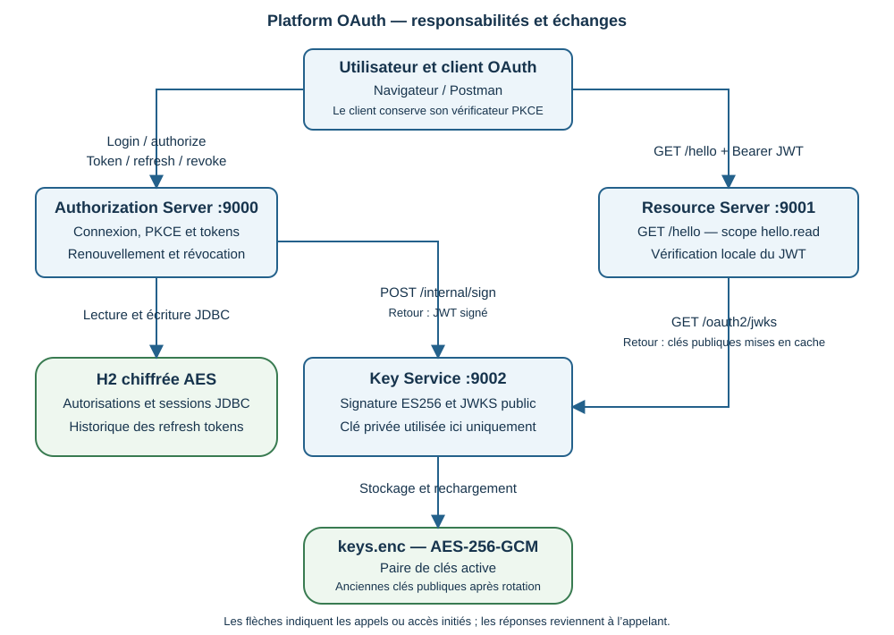
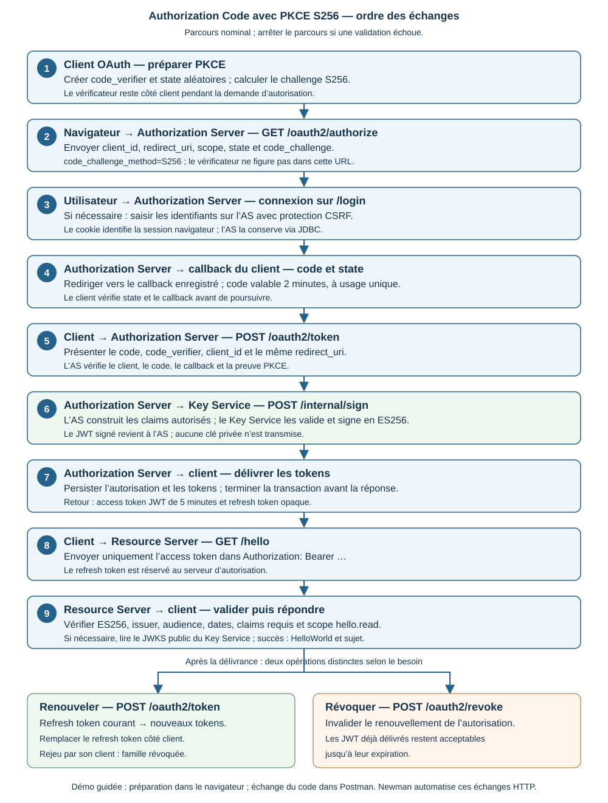

# Mini plateforme OAuth 2.0

Auteur   : Akoélé AKOESSO

LinkedIn : https://www.linkedin.com/in/nakoesso

## Description

Cette application est une plateforme conçue avec  Java 25 / Spring Boot 4.1.2 qui démontre comment sécuriser l’accès à une API avec **OAuth 2.0 Authorization Code et PKCE S256**.

Un utilisateur se connecte sur un serveur d’autorisation. Une application cliente obtient ensuite un token lui permettant d’appeler une API protégée, sans recevoir le mot de passe de cet utilisateur.

Le projet couvre le renouvellement des tokens, la détection de leur réutilisation, leur révocation et la gestion des clés de signature.

## 1. Architecture

La plateforme comporte trois applications :

| Service | Port | Responsabilité |
| --- | ---: | --- |
| Authorization Server | 9000 | Connexion utilisateur, validation PKCE, délivrance et renouvellement des tokens, révocation |
| Resource Server | 9001 | API protégée `GET /hello`, validation du JWT et du scope `hello.read` |
| Key Service | 9002 | Signature des JWT, publication des clés publiques et rotation des clés |



### Lecture des flux d’architecture

Les flèches indiquent les appels ou accès initiés ; les réponses reviennent à l’appelant. Elles représentent les dépendances entre composants, tandis que le diagramme de la section suivante décrit leur ordre d’exécution.

**1. Navigateur et client → Authorization Server : se connecter et obtenir des droits.** Le navigateur présente la demande d’autorisation sur `GET /oauth2/authorize`. Si aucune session valide n’existe, l’utilisateur se connecte sur `/login`, avec protection CSRF. Son mot de passe est envoyé au serveur d’autorisation. Le client échange ensuite un code temporaire sur `POST /oauth2/token` avec la preuve PKCE. Le même endpoint sert au renouvellement ; `POST /oauth2/revoke` permet la révocation. Le cookie de connexion identifie la session navigateur : il ne remplace pas le Bearer utilisé pour appeler l’API.

**2. Authorization Server ↔ H2 : conserver l’état OAuth et les sessions.** L’AS lit et écrit les autorisations, les codes et tokens associés, les sessions JDBC et l’historique des empreintes SHA-256 des refresh tokens. H2 est chiffrée avec `OAUTH_STORAGE_KEY`. La persistance permet de retrouver cet état après un redémarrage avec le même répertoire et la même clé. Les comptes utilisateurs et les clients OAuth sont, eux, reconstruits depuis la configuration au démarrage. Les échanges de code, renouvellements et révocations sont protégés par une transaction et un verrou JDBC ; une réponse contenant des tokens n’est envoyée qu’après commit.

**3. Authorization Server → Key Service : signer le JWT.** Après validation des droits, l’AS construit les claims du token, notamment le sujet, l’audience `portage-api` et le scope `hello.read`. Il appelle `POST /internal/sign` avec le compte technique de signature et le secret `KEY_SERVICE_SIGNING_SECRET`. Le Key Service contrôle les claims et retourne un JWT signé en ES256 avec sa clé privée active. Cette clé privée n’est jamais envoyée à l’AS. Une panne du signataire empêche l’émission de nouveaux JWT : aucune signature locale de secours n’est prévue.

**4. Key Service ↔ keys.enc : conserver et renouveler les clés.** Le service recharge ou crée sa paire de clés EC P-256 et persiste son état dans `keys.enc`, chiffré en AES-256-GCM avec `KEY_SERVICE_MASTER_KEY`. Par défaut, il renouvelle la clé de signature toutes les 24 heures et conserve les anciennes clés publiques pendant 900 secondes. Les JWT déjà délivrés restent ainsi vérifiables pendant leur durée de validité. La rotation manuelle passe par `POST /internal/rotate` et un compte d’administration distinct ; le compte de signature ne dispose pas de ce droit.

**5. Client → Resource Server : utiliser les droits accordés.** Le client appelle `GET /hello` avec `Authorization: Bearer <access_token>`. Le Resource Server vérifie la signature ES256, l’émetteur, l’audience, les dates, les claims requis et le scope `hello.read`. Si les contrôles réussissent, il retourne `HelloWorld` et le sujet de l’utilisateur. Il ne reçoit ni le mot de passe utilisateur ni le refresh token, et ne crée pas de session HTTP pour cet accès.

**6. Resource Server → Key Service : obtenir les clés publiques.** Pour vérifier une signature, le RS utilise le JWKS exposé sur `GET /oauth2/jwks`. Le champ `kid` du JWT identifie la clé à rechercher. Les clés publiques sont mises en cache : le RS ne contacte donc pas l’AS à chaque requête, ni nécessairement le Key Service. Une clé inconnue peut nécessiter une récupération du JWKS. Si le Key Service est indisponible, les vérifications peuvent continuer avec les clés déjà disponibles en cache ; une récupération nécessaire peut échouer.

**Frontières de confiance.** Seul le Key Service conserve la clé privée de signature. Le secret technique de signature est partagé avec l’AS ; le secret d’administration et la clé maîtresse restent destinés au Key Service. Les deux stockages utilisent des clés de chiffrement distinctes. Les connexions HTTP présentées sont celles de la démonstration locale ; un déploiement demande TLS. Enfin, la vérification locale du JWT explique pourquoi révoquer un refresh token ne bloque pas immédiatement un access token déjà délivré.

### Organisation du dépôt

| Emplacement | Contenu |
| --- | --- |
| `authorization-server/` | Serveur d’autorisation et démonstration navigateur |
| `resource-server/` | API protégée |
| `key-service/` | Service de signature et stockage des clés |
| `coverage/` | Rapport JaCoCo agrégé et contrôle des seuils |
| `postman/pkce.collection.json` | Parcours PKCE manuel et automatisé |
| `scripts/` | Vérification, démonstration Newman, couverture, scan et génération du PDF |
| `docs/` | Architecture, contrats, guides et traçabilité |

## 2. Fonctionnement du parcours PKCE

Le dessin suivant se lit de haut en bas : les étapes 1 à 9 conduisent de la préparation PKCE à l’accès à l’API. Les deux blocs finaux décrivent des opérations ultérieures, le renouvellement et la révocation.



### Description détaillée du parcours

**1. Préparer la demande côté client.** Le client génère un `code_verifier` aléatoire et un `state` indépendant. Il calcule `code_challenge = BASE64URL(SHA256(code_verifier))`, sans padding. Le vérificateur est conservé côté client jusqu’à l’échange du code ; seul le challenge est transmis dans la demande d’autorisation. La méthode annoncée est `S256`, obligatoire pour les deux clients configurés.

**2. Demander l’autorisation dans le navigateur.** Le client ouvre `GET /oauth2/authorize` avec `response_type=code`, `client_id`, `redirect_uri`, `scope=hello.read`, `state`, `code_challenge` et `code_challenge_method=S256`. L’AS contrôle notamment le client, le callback enregistré, les droits demandés et les paramètres PKCE. Le callback indique où renvoyer le résultat ; il doit correspondre à une adresse enregistrée pour ce client.

**3. Authentifier l’utilisateur.** Sans session valide, le navigateur est dirigé vers `/login`. L’utilisateur y saisit ses identifiants ; le formulaire est protégé par un jeton CSRF. Après connexion, l’AS reprend la demande OAuth initiale. Si une session valide existe déjà, une nouvelle saisie du mot de passe n’est pas nécessaire. Les deux clients internes de démonstration ne demandent pas d’écran de consentement explicite.

**4. Recevoir et contrôler le callback.** L’AS redirige vers le callback avec `code` et `state`. Le client vérifie que le state correspond à la demande et que le retour est cohérent avec le callback attendu. En cas d’erreur, il arrête le parcours. Le code obtenu est lié à cette autorisation, expire après deux minutes et ne sert qu’une fois ; il ne permet pas d’appeler directement l’API.

**5. Échanger le code contre des tokens.** Le client envoie à `POST /oauth2/token` un formulaire `application/x-www-form-urlencoded` contenant `grant_type=authorization_code`, le code, `client_id`, le même `redirect_uri` et `code_verifier`. Pour `demo-client`, il ajoute l’authentification HTTP Basic ; `portage-public` n’a pas de secret client. L’AS vérifie le code et sa liaison au client et au callback, puis recalcule le challenge à partir du vérificateur reçu.

**PKCE protège cet échange : un code intercepté seul ne suffit pas à obtenir les tokens sans le vérificateur correspondant.** Le state sert à corréler la réponse avec la demande initiale ; il ne remplace pas la preuve PKCE.

**6. Faire signer l’access token.** L’AS construit les claims autorisés et demande au Key Service de signer le JWT via `POST /internal/sign`. Le Key Service utilise la clé privée ES256 active et ajoute son identifiant `kid`. Il retourne le JWT signé, sans transmettre de clé privée. Le sujet est l’identifiant stable de l’utilisateur, par exemple `subject-1`, et non une identité librement choisie par le client.

**7. Persister puis retourner les tokens.** L’AS conserve l’autorisation et les tokens via son service JDBC. Après commit, il renvoie l’access token, le refresh token, le type Bearer, le scope et la durée de validité. L’access token dure cinq minutes ; le refresh token est opaque et possède sa propre échéance. Le client doit protéger les deux valeurs et ne pas les exposer dans des logs ou des exports.

**8. Appeler la ressource protégée.** Le client envoie `GET /hello` au port 9001 avec l’access token dans l’en-tête Bearer. Il n’utilise ni le code d’autorisation, ni le cookie de connexion, ni le refresh token pour cet appel.

**9. Vérifier le JWT puis répondre.** Le RS utilise la clé publique correspondant au `kid`, obtenue via le JWKS ou déjà en cache. Il contrôle la signature, l’issuer, l’audience `portage-api`, les dates et claims requis, puis le scope `hello.read`. Une réussite produit une réponse 200 contenant `HelloWorld` et le sujet. Un token absent ou invalide produit 401 ; un JWT valide sans le droit requis produit 403. La présence du scope est contrôlée en plus de la validité cryptographique.

### Après l’accès : renouveler ou révoquer

**Renouveler.** Le client présente le refresh token courant sur `POST /oauth2/token` avec `grant_type=refresh_token` et son identification client. L’AS vérifie la famille, l’expiration et les droits, puis délivre un nouvel access token et un nouveau refresh token. Le client remplace immédiatement l’ancien refresh token. Chaque token dure au plus huit heures, et sa date de fin reste bornée par les sept jours maximum de la famille.

**Détecter un rejeu.** Si un ancien refresh token est réutilisé par son client d’origine, l’AS retrouve son empreinte dans l’historique et révoque toute la famille, y compris le dernier refresh token délivré. Un autre client est refusé sans détruire la famille du propriétaire. Les renouvellements doivent être sérialisés : deux appels concurrents avec la même valeur peuvent déclencher cette protection.

**Révoquer explicitement.** Le client appelle `POST /oauth2/revoke` avec le refresh token et son identification client. L’autorisation concernée ne permet plus de renouveler les tokens. Un JWT déjà délivré reste cependant acceptable jusqu’à son expiration, car le RS le valide localement. Se déconnecter du navigateur ne révoque pas implicitement les tokens OAuth.

### Correspondance avec la démonstration du projet

Dans la démonstration guidée, le navigateur assure la préparation PKCE, la connexion et le contrôle du callback. Le vérificateur et le state sont gardés temporairement dans le `sessionStorage` de l’onglet, puis supprimés au retour. La page affiche les valeurs à copier dans Postman ; **elle ne réalise pas automatiquement l’échange de code** et n’expose pas de secret client.

Postman joue ensuite le rôle du client pour échanger le code, appeler l’API et manipuler les refresh tokens. Le dossier Newman **Automated PKCE** automatise ces échanges HTTP, y compris la connexion avec cookie et CSRF, sans interaction manuelle avec un navigateur.

| Token | Utilisation |
| --- | --- |
| Access token | JWT signé envoyé à l’API dans l’en-tête `Authorization: Bearer …` |
| Refresh token | Token opaque présenté au serveur d’autorisation pour obtenir de nouveaux tokens |

Le JWT est **signé, mais pas chiffré** : son contenu peut être lu. Sa signature permet de vérifier son intégrité et son origine.

## 3. Démarrage rapide : démonstration automatisée

Cette méthode vérifie le parcours complet sans configurer manuellement les secrets.

### Prérequis

- JDK 25 ;
- Maven 3.9 ou supérieur ;
- Python 3 ;
- Node.js avec npm ;
- ports 9000, 9001 et 9002 disponibles.

Les commandes ci-dessous sont utilisables dans Git Bash sous Windows.

```bash
java -version
mvn -version
python --version
node --version
```

`JAVA_HOME` doit pointer vers le répertoire du JDK, sans le suffixe `/bin`. Vérifier que `mvn -version` indique Java 25.

### Exécuter la démonstration

Depuis la racine du projet :

```bash
npm install --no-save --package-lock=false newman
python scripts/demo-pkce.py
```

Le script :

- construit et vérifie le projet ;
- génère des secrets et des stockages temporaires ;
- démarre les trois services ;
- exécute la collection Newman PKCE ;
- arrête les services et supprime les stockages temporaires.

Pour utiliser des JAR déjà construits :

```bash
python scripts/demo-pkce.py --skip-build
```

Les rapports assainis sont disponibles dans :

```text
.work/reports/newman-pkce.json
.work/reports/newman-pkce.xml
```

Ils ne contiennent pas les mots de passe, cookies ou tokens. Un échec produit un code de sortie non nul.

## 4. Démarrage manuel des services

Utiliser cette méthode pour explorer le projet dans le navigateur et Postman, ou conserver les données entre deux démarrages.

### Construire les applications

```bash
mvn clean verify
```

### Configurer les variables d’environnement

| Variable | Destination | Utilisation |
| --- | --- | --- |
| `OAUTH_USER1_PASSWORD` à `OAUTH_USER5_PASSWORD` | Authorization Server | Cinq mots de passe distincts pour `user1` à `user5` |
| `OAUTH_CLIENT_SECRET` | Authorization Server | Secret du client `demo-client` |
| `OAUTH_STORAGE_KEY` | Authorization Server | Clé de chiffrement H2 : 32 octets aléatoires encodés en Base64 |
| `KEY_SERVICE_MASTER_KEY` | Key Service | Autre clé de 32 octets aléatoires encodés en Base64 |
| `KEY_SERVICE_SIGNING_SECRET` | Authorization Server et Key Service | Secret partagé pour autoriser la signature, au moins 32 caractères |
| `KEY_SERVICE_ADMIN_SECRET` | Key Service | Secret distinct pour administrer la rotation, au moins 32 caractères |
| `OAUTH_SECURE_COOKIE` | Authorization Server | `false` pour les essais HTTP locaux ; `true` par défaut |

Dans Git Bash, une variable se définit ainsi :

```bash
export OAUTH_USER1_PASSWORD='votre-mot-de-passe-local'
```

Cette valeur est un exemple à remplacer. Renseigner toutes les variables requises avant de démarrer les services.

Pour générer une clé de 32 octets en Base64 :

```bash
python -c "import base64,secrets; print(base64.b64encode(secrets.token_bytes(32)).decode())"
```

Effectuer deux générations distinctes pour `OAUTH_STORAGE_KEY` et `KEY_SERVICE_MASTER_KEY`, puis conserver leurs valeurs pour les redémarrages.

Les variables doivent être présentes dans **chaque terminal qui démarre le service concerné**. Le Resource Server n’a besoin ni des mots de passe ni des clés de chiffrement.

`java -jar` ne charge pas automatiquement les fichiers `.env`. Ne pas commiter les secrets.

### Démarrer les applications

Depuis la racine du projet, utiliser trois terminaux et démarrer les services dans cet ordre :

```bash
java -jar key-service/target/key-service-1.0.0-SNAPSHOT-exec.jar
```

```bash
java -jar authorization-server/target/authorization-server-1.0.0-SNAPSHOT.jar
```

```bash
java -jar resource-server/target/resource-server-1.0.0-SNAPSHOT.jar
```

### Configuration facultative

| Variable | Valeur par défaut |
| --- | --- |
| `OAUTH_REDIRECT_URI` | `http://127.0.0.1:8080/callback` |
| `OAUTH_DEMO_REDIRECT_URI` | `http://127.0.0.1:9000/demo/callback` |
| `OAUTH_STORAGE_DIRECTORY` | `runtime-auth` |
| `KEY_SERVICE_DIRECTORY` | `runtime-keys/key-service` |
| `KEY_SERVICE_URL` | `http://127.0.0.1:9002` |
| `RESOURCE_SERVER_JWKS_URI` | `http://127.0.0.1:9002/oauth2/jwks` |

Le callback de démonstration doit utiliser la même origine que la page et le chemin `/demo/callback`. Une exposition sur une autre adresse demande aussi une configuration cohérente de l’issuer et de sa validation ; changer uniquement le callback ne suffit pas.

## 5. Explorer le parcours dans le navigateur et Postman

1. Ouvrir `http://127.0.0.1:9000/login`.
2. Se connecter avec un compte configuré, par exemple `user1`.
3. Cliquer sur **Démarrer une autorisation PKCE**.
4. Après le retour sur `/demo/callback`, récupérer les valeurs affichées.
5. Importer `postman/pkce.collection.json`.
6. Choisir le dossier **Manual code**.
7. Renseigner `authorization_code`, `code_verifier` et le `redirect_uri` exact affiché par la page.
8. Exécuter les requêtes dans l’ordre au sein d’un même run.

Pour le parcours navigateur par défaut, le callback à renseigner est `http://127.0.0.1:9000/demo/callback`, et non le callback générique sur le port 8080.

**Le code expire après deux minutes et ne peut être échangé qu’une fois.**

La page prépare le parcours et vérifie le retour. Elle ne réalise pas automatiquement l’échange de tokens. Utiliser le même onglet pendant tout le parcours : le vérificateur et le state sont conservés temporairement dans `sessionStorage`, puis supprimés au retour.

Une connexion commencée depuis une demande OAuth reprend cette demande après le login.

La collection propose aussi un dossier **Automated PKCE**. Son utilisation demande les variables `username` et `password`, le cookie jar actif et le suivi automatique des redirections désactivé.

Les tokens intermédiaires sont locaux au run : pour des envois indépendants avec **Send**, suivre le [plan manuel Postman](docs/PLAN_TEST_MANUEL_POSTMAN_PKCE.md). Ne pas exporter les valeurs sensibles.

### Clients disponibles

| Client | Authentification | PKCE |
| --- | --- | --- |
| `portage-public` | Sans secret client | S256 obligatoire |
| `demo-client` | HTTP Basic au token endpoint | S256 obligatoire |

Le lanceur Newman fourni utilise le client public. Les tests Java couvrent également le client confidentiel. Pour ce dernier, adapter les requêtes Postman avec son identifiant, son callback enregistré et HTTP Basic sur les endpoints token et révocation.

### Appeler l’API

```http
GET http://127.0.0.1:9001/hello
Authorization: Bearer <access_token>
```

Exemple de réponse :

```json
{
  "message": "HelloWorld",
  "subject": "subject-1"
}
```

Le serveur vérifie la signature ES256, l’émetteur, l’audience `portage-api`, les dates, les claims requis et le scope `hello.read`.

## 6. Renouvellement et révocation

| Élément | Durée |
| --- | --- |
| Code d’autorisation | 2 minutes, usage unique |
| Access token | 5 minutes |
| Refresh token | 8 heures depuis son émission |
| Famille de refresh tokens | 7 jours au maximum |
| Session navigateur | 30 minutes d’inactivité |

À chaque renouvellement sur `POST /oauth2/token` avec `grant_type=refresh_token`, le serveur remplace le refresh token. Le client doit conserver la nouvelle valeur. Son expiration est bornée par la limite absolue de sa famille.

Si un ancien refresh token est réutilisé par son client d’origine, le serveur révoque toute sa famille, y compris le dernier refresh token délivré.

Les renouvellements doivent être sérialisés côté client : deux demandes utilisant simultanément le même refresh token peuvent déclencher cette protection.

La révocation explicite se fait sur `POST /oauth2/revoke`.

**La révocation n’invalide pas immédiatement les JWT déjà délivrés.** Ils restent utilisables jusqu’à leur expiration, car le Resource Server les vérifie localement. La déconnexion de la session navigateur ne révoque pas implicitement les tokens.

## 7. Stockage et clés

L’Authorization Server conserve les autorisations et sessions JDBC dans une base H2 chiffrée.

Le Key Service conserve sa paire de clés active dans :

```text
runtime-keys/key-service/keys.enc
```

Ce chemin est relatif au répertoire de lancement, sauf configuration explicite. Le fichier est chiffré en AES-256-GCM avec `KEY_SERVICE_MASTER_KEY`.

La rotation de signature intervient par défaut toutes les 24 heures. Les anciennes clés publiques sont conservées 900 secondes après rotation pour vérifier les JWT encore valides. L’ancienne clé privée n’est plus conservée dans l’état persistant courant.

Les clés publiques sont accessibles sur :

```http
GET http://127.0.0.1:9002/oauth2/jwks
```

Pour retrouver les données après redémarrage, conserver les répertoires persistants **et les mêmes clés de chiffrement**. Sauvegarder les clés de chiffrement séparément des données.

## 8. Tests et rapports

```bash
mvn clean verify
```

Ce cycle exécute les tests JUnit, HTTP et BDD Cucumber, puis contrôle une couverture minimale de **80 % des lignes par service et sur l’ensemble pondéré**.

Les tests démarrent leurs instances isolées ; il n’est pas nécessaire de lancer les services manuellement.

| Rapport | Emplacement |
| --- | --- |
| Tests unitaires et HTTP | `*/target/surefire-reports/` |
| Suites Cucumber | `*/target/failsafe-reports/` |
| Rapports Cucumber HTML | `*/target/cucumber/cucumber.html` |
| Couverture par service | `*/target/site/jacoco/` |
| Couverture agrégée | `coverage/target/site/jacoco-aggregate/` |
| Résumé de couverture | `docs/evidence/coverage.json` |

Scénarios BDD : [Authorization Code PKCE](authorization-server/src/test/resources/features/authorization-code-pkce.feature) et [ressource protégée](resource-server/src/test/resources/features/hello.feature).

Tests JavaScript de la démonstration :

```bash
node --test authorization-server/src/test/js/demo.test.mjs
```

Pour conserver des preuves datées avec logs assainis :

```bash
python scripts/verify.py
```

Ce script utilise le cache Maven `.work/m2`. L’option `--offline` nécessite un cache déjà alimenté. Les rapports détaillés restent dans `.work/reports/`, ignoré par Git.

## 9. Docker

Construire les JAR, puis lancer :

```bash
mvn clean verify
docker compose up --build
```

Compose utilise les variables d’environnement ou son fichier `.env`.

Deux volumes conservent les données :

- `authorization-data` pour l’Authorization Server ;
- `signing-keys` pour le Key Service.

Pour les essais HTTP locaux avec connexion navigateur, transmettre `OAUTH_SECURE_COOKIE=false` à l’Authorization Server au moyen d’une surcharge Compose locale. Définir la variable dans `.env` seul ne suffit pas : le fichier Compose doit la transmettre au service. Exemple de fichier `compose.override.yaml` :

```yaml
services:
  authorization-server:
    environment:
      OAUTH_SECURE_COOKIE: "false"
```

Les ports publiés sont limités à `127.0.0.1`. Ne pas supprimer les volumes pour un simple redémarrage.

## 10. Limites et dépannage

Cette plateforme est une démonstration locale à instance unique. Un déploiement en production demande notamment TLS, une gestion opérationnelle des secrets, une stratégie de haute disponibilité et une gestion des clés adaptée.

Les utilisateurs et clients sont configurés en mémoire au démarrage. Le projet ne propose pas de révocation immédiate des JWT, de réplication, de purge automatique des familles expirées ou de rotation automatique des clés maîtresses.

| Problème | Vérification |
| --- | --- |
| Maven refuse de démarrer | Vérifier `JAVA_HOME` et `mvn -version` |
| La démonstration refuse les ports | Arrêter les services déjà présents sur 9000–9002 |
| La connexion ne persiste pas en HTTP | Vérifier `OAUTH_SECURE_COOKIE=false` et utiliser toujours `127.0.0.1` |
| L’échange du code échoue | Vérifier son expiration, son usage unique, le vérificateur et le callback exact |
| `/hello` retourne 401 | Vérifier la présence et la validité du JWT |
| `/hello` retourne 403 | Vérifier le scope `hello.read` |
| Le stockage ne se recharge pas | Vérifier le répertoire et la clé de chiffrement d’origine |

## 11. Documentation complémentaire

- [Architecture](docs/ARCHITECTURE.md)
- [Contrat PKCE et cycle des tokens](docs/AUTHORIZATION_CODE_PKCE.md)
- [Gestion des clés](docs/KEY_SERVICE.md)
- [Plan de test Postman](docs/PLAN_TEST_MANUEL_POSTMAN_PKCE.md)
- [Spécification](docs/SPECIFICATION.md)
- [Traçabilité des exigences](docs/REQUIREMENTS_TRACEABILITY.md)
- [Architecture et scénarios en PDF](docs/PLATFORM_OAUTH_ARCHITECTURE_ET_SCENARIOS.pdf)

Relire les rapports JaCoCo existants :

```bash
python scripts/check-coverage.py
```

Le script PowerShell `scripts/scan-cves.ps1` permet un scan avec Trivy ou Grype lorsqu’ils sont installés.

Le PDF d’architecture peut être régénéré avec `python scripts/build-architecture-pdf.py`. Ce générateur nécessite `reportlab`, `pypdf` et les polices Windows Segoe UI/Consolas.
