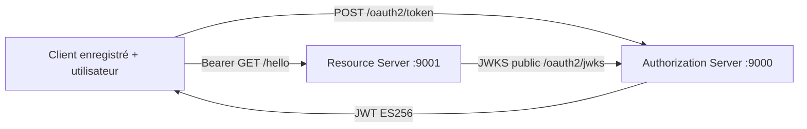

# Architecture et contrats avant code

> Évolution ultérieure : l'architecture courante comprend désormais un troisième service de clés et de signature. Voir [KEY_SERVICE.md](KEY_SERVICE.md) pour le stockage chiffré, la rotation et les nouveaux flux. Le texte ci-dessous conserve la décision initiale à deux services.

Décision initiale du 2026-10-27. Deux applications Maven Java 25 / Spring Boot 4.1.2, Spring Security OAuth2 Authorization Server et Resource Server. Aucun code antérieur réutilisé.

## Propriété et frontières

AS possède utilisateurs, encodage des mots de passe, clients, clés privées et émission. RS ne reçoit que le JWKS public et vérifie ES256, P-256, kid, signature, issuer, audience, exp, nbf et scope. Aucune dépendance applicative entre les modules. HTTP loopback réservé à la démonstration ; TLS indispensable hors poste local. Les tokens et secrets ne sont jamais imprimés dans les preuves.

## Contrats communs figés

- AS `http://127.0.0.1:9000`, issuer identique ; RS `http://127.0.0.1:9001` ; audience `portage-api` ; durée du jeton 300 secondes.
- `POST /oauth2/token`, content-type `application/x-www-form-urlencoded`, HTTP Basic client `demo-client` et secret env `OAUTH_CLIENT_SECRET`. Corps `grant_type=urn:portage:params:oauth:grant-type:subject&username=<login>&password=<secret>&subject=<subject>&scope=hello.read`. Grant d'extension traité par le framework (converter/provider), client authentifié et autorisé avant émission. Aucun grant password standard ni émission anonyme.
- Réponse OAuth standard `{access_token,token_type:"Bearer",expires_in,scope}` ; headers cache-control no-store. Claims `iss,sub,aud,iat,nbf,exp,jti,scope`, alg ES256 et kid.
- `GET /oauth2/jwks` public, clés actives et suivantes P-256, jamais champ privé. `GET /hello` avec `SCOPE_hello.read` retourne JSON `{"message":"HelloWorld","subject":""}`.
- Sujet demandé différent du sujet de l'utilisateur : `invalid_grant`. Mauvais utilisateur/mot de passe : même erreur. Client inconnu/mauvais secret : `invalid_client`. Grant/scope non autorisé : erreurs OAuth adaptées.
- RS 401 token absent/invalide, 403 scope insuffisant. Réponses JSON sobres, sans détail de vérification ni stack trace. Advice pour erreurs contrôleur, handlers explicites pour erreurs avant contrôleur.
- Configuration AS `platform.users[0..4].username/password/subject` (identifiants user1..user5 et sujets subject-1..subject-5), passwords `${OAUTH_USER1_PASSWORD}` ... `${OAUTH_USER5_PASSWORD}` ; client secret `${OAUTH_CLIENT_SECRET}` ; chemins `runtime-keys/active.jwk` et `runtime-keys/next.jwk`. Propriétés manquantes échouent au démarrage.
- Simulation suivante : processus local de démonstration indépendant signe avec `next.jwk`, mêmes claims ; RS accepte le kid prépublié. Pas d'API permettant de demander une clé de signature arbitraire.

## Tests et décisions

JUnit vérifie chargement des cinq utilisateurs, encodage/unicité/configuration manquante, émission autorisée/refusée, signatures et erreurs ; Cucumber traverse les chaînes HTTP des deux services. Tests RS avec vrais JWT locaux : algorithme inattendu/none, signature altérée, dates, issuer/audience, kid, scope. Newman et script local valident les deux clés et les cas négatifs sans sortir les tokens. JaCoCo 0.8.14 minimum supportant Java25 ; check 80% lignes par service et somme pondérée via module coverage vérifié pendant verify. Aucun code métier/sécurité exclu.

Alternative écartée : JWT/protocole entièrement artisanal. Le framework fournit authentification client et erreurs OAuth, Nimbus implémente la cryptographie. Pas de gateway, bus, base ou SDK IA pour ce périmètre.

Limites production : grant pédagogique transportant mot de passe, utilisateurs et clients mémoire, absence de rotation complète, haute disponibilité, audit persistant, anti-bruteforce distribué, TLS et gestionnaire de secrets. Révocation d'un JWT autonome ne prend effet qu'à expiration ; pas de promesse de révocation immédiate.
