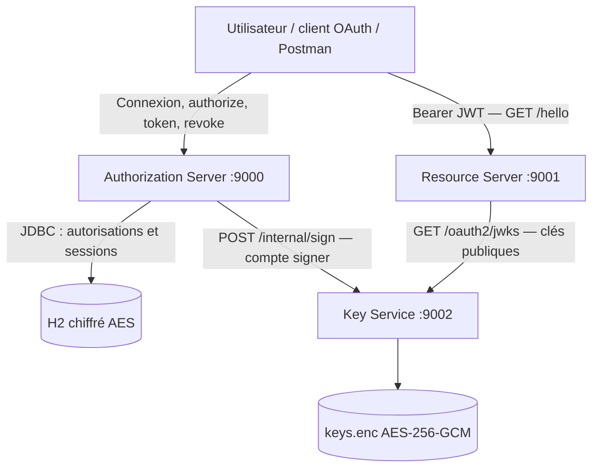

# Architecture courante

Trois applications Java 25 / Spring Boot 4.1.2 séparent la gestion des autorisations,
la protection des ressources et la cryptographie. Le flux utilisateur courant est
Authorization Code avec PKCE S256.

## Responsabilités

| Service | Possède | Ne reçoit pas |
| --- | --- | --- |
| Authorization Server | Identités configurées, clients, codes, autorisations, refresh tokens, sessions | Clés privées de signature |
| Resource Server | Règles d’accès et cache des clés publiques | Mots de passe, refresh tokens, clés privées |
| Key Service | Clé privée active, anciennes clés publiques et politique de rotation | Sessions de connexion et base d’autorisations |

Les utilisateurs et les deux clients sont reconstruits depuis la configuration au démarrage.
Spring persiste les autorisations et les sessions dans H2. Le service JDBC de consentement
est disponible ; les deux clients internes configurés n’exigent pas d’écran de consentement.

## Émission et accès

1. L’utilisateur se connecte sur `/login`, avec protection CSRF.
   Une connexion directe aboutit à l’accueil `/`, qui propose un client public de démonstration.
2. Le client appelle `/oauth2/authorize` avec un challenge S256 et un callback enregistré.
3. Le code retourné est échangé sur `/oauth2/token` avec le `code_verifier` correspondant.
4. L’AS valide le client et les droits, demande la signature au Key Service, puis persiste les tokens.
5. Le client présente le JWT à `/hello`. Le RS vérifie signature, issuer, audience, dates et scope.

Le sujet du JWT est `subject-N`, son audience est `portage-api` et son scope est `hello.read`.
Le client confidentiel `demo-client` utilise HTTP Basic ; `portage-public` ne possède pas de secret.

La démonstration navigateur génère son vérificateur et son state via Web Crypto,
les conserve temporairement dans l’onglet et valide le retour sur `/demo/callback`.
Le serveur sert les ressources protégées via `DemoController` ; le code et le
vérificateur sont ensuite copiés dans Postman pour l’échange. Aucun token ni secret
client n’est conservé par cette interface.

## Renouvellement et révocation

`RotatingAuthorizationService` enveloppe le composant Spring `JdbcOAuth2AuthorizationService`.
L’historique stocke les empreintes SHA-256 des refresh tokens et leur famille.
La transaction et le verrou JDBC englobent l’échange de code, le renouvellement et la révocation.
La réponse contenant les nouveaux tokens est envoyée après commit.

Chaque renouvellement remplace le refresh token. Rejouer un ancien token avec son client
d’origine invalide la famille, y compris son dernier token. Un autre client est refusé
sans détruire la famille du propriétaire. Les JWT déjà délivrés restent vérifiables jusqu’à expiration.

## Stockage et limites

`OAUTH_STORAGE_KEY` protège la base H2 ; `KEY_SERVICE_MASTER_KEY` protège `keys.enc`.
Ces clés sont distinctes des secrets HTTP Basic et doivent être conservées séparément des sauvegardes.
Les volumes Docker `authorization-data` et `signing-keys` persistent aux redémarrages.

L’architecture est locale et à instance unique. TLS, haute disponibilité, HSM/KMS,
purge automatique des familles expirées et rotation des clés maîtresses demandent des évolutions dédiées.

## Documents détaillés

- [Contrat PKCE et cycle des tokens](AUTHORIZATION_CODE_PKCE.md)
- [Key Service et rotation cryptographique](KEY_SERVICE.md)
- [Recette manuelle Postman](PLAN_TEST_MANUEL_POSTMAN_PKCE.md)
- [PDF avec schémas et 56 scénarios](PLATFORM_OAUTH_ARCHITECTURE_ET_SCENARIOS.pdf)
