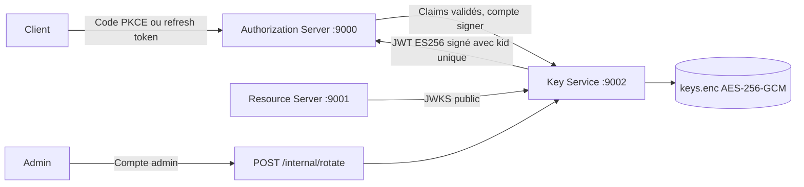

# Service de clés et de signature

Le Key Service possède les clés de signature de la plateforme. Le serveur d’autorisation
l’appelle pour émettre les JWT du flux Authorization Code avec PKCE.



## Responsabilités

Le serveur d'autorisation authentifie le client et l'utilisateur, vérifie le sujet et les scopes et construit les claims. Son `JwtEncoder` appelle le service de signature avec des délais de connexion de trois secondes et de réponse de cinq secondes. Il ne charge, ne génère et ne stocke aucune clé privée. Un échec de signature bloque l’émission, sans secours sur une clé locale. Le statut exact des erreurs du générateur Spring doit être vérifié par une recette de panne PKCE ; aucun mécanisme de signature locale de secours n’est prévu.

Le Key Service génère une clé EC P-256 au premier démarrage, lui attribue un UUID comme `kid`, stocke l'état chiffré et signe en ES256. Il refuse les claims dont l'issuer, l'audience ou le scope diffèrent du contrat et limite la validité à 300 secondes. L'en-tête JWT et le choix de la clé appartiennent au Key Service.

Le Resource Server utilise par défaut `http://127.0.0.1:9002/oauth2/jwks`, maintient ses validations d'issuer, audience, dates et scope et vérifie localement les signatures. L'URL historique `http://127.0.0.1:9000/oauth2/jwks` reste disponible comme proxy public pour la découverte OAuth et les consommateurs existants.

## API et accès

| Méthode et chemin | Accès | Résultat |
| --- | --- | --- |
| `GET /oauth2/jwks` | Public | Clé active et anciennes clés publiques encore retenues |
| `POST /internal/sign` | HTTP Basic, utilisateur `signer` | Corps : claims JWT ; réponse : `{"token":"..."}` |
| `POST /internal/rotate` | HTTP Basic, utilisateur `admin` | Nouvelle clé active ; réponse : `kid` et `activatedAt` |

Les deux secrets doivent être distincts et compter au moins 32 caractères. Le compte signer ne peut pas effectuer de rotation ; le compte admin ne peut pas signer. Les autres routes sont refusées. Les réponses de signature et JWKS utilisent `Cache-Control: no-store`. Les rotations réussies sont journalisées avec leur identifiant public et leur date, sans matériel privé.

## Persistance et rotation

L'état est enregistré dans `${KEY_SERVICE_DIRECTORY}/keys.enc`, chiffré en AES-256-GCM avec un nonce aléatoire par écriture. La clé maîtresse est fournie séparément par `KEY_SERVICE_MASTER_KEY` (32 octets encodés en Base64). Le fichier comprend la clé privée active, sa date d'activation et les anciennes clés **publiques** avec leur échéance. Après une rotation réussie, l'ancienne clé privée n'est plus dans l'état persistant courant.

Une écriture passe par un fichier temporaire aux permissions restreintes, un flush et un remplacement atomique. Si le remplacement échoue, la rotation échoue et l'ancienne clé reste active en mémoire. Un fichier corrompu ou une mauvaise clé maîtresse empêche le démarrage ; le service ne régénère pas silencieusement une identité.

Un verrou de fichier interdit deux instances sur le même répertoire. Sous POSIX, les permissions appliquées sont 0700 pour le répertoire et 0600 pour le fichier. Sous Windows, les ACL sont héritées : utiliser un répertoire accessible uniquement au compte du service et aux administrateurs autorisés.

La rotation automatique intervient après 24 heures, avec une vérification toutes les 30 secondes. Une rotation manuelle peut être demandée à tout moment. L'ancienne clé publique est conservée 900 secondes après la bascule : les JWT de 300 secondes continuent donc d'être vérifiables. Chaque nouvelle clé possède un nouveau `kid`, ce qui permet au décodeur Nimbus de rechercher la nouvelle clé quand il rencontre cet identifiant. La rétention minimale configurable est 600 secondes. Les clés expirées sont omises du JWKS et retirées du fichier à la rotation suivante.

Propriétés Spring :

| Propriété | Défaut |
| --- | --- |
| `platform.keys.rotation-seconds` | `86400` (minimum 60) |
| `platform.keys.retention-seconds` | `900` (minimum 600) |
| `platform.keys.check-interval-ms` | `30000` |
| `platform.keys.issuer` | `http://127.0.0.1:9000` |

Il faut sauvegarder **le fichier chiffré et la clé maîtresse séparément**, et conserver la même clé maîtresse au redémarrage. Le renouvellement de la clé maîtresse n'est pas implémenté. Les anciens fichiers JWK de démonstration ne sont pas importés : lors du passage à cette architecture, les anciens jetons doivent expirer ou les consommateurs doivent être migrés avec une procédure dédiée.

## Démarrage local

Prérequis : Java 25, Maven, Python 3. Définir `JAVA_HOME` sur le JDK installé.

Pour une démonstration PKCE complète avec secrets temporaires, Newman et arrêt des services :

```bash
python scripts/demo-pkce.py
```

Après un build réussi, `python scripts/demo-pkce.py --skip-build` utilise les JAR existants.
Voir le [plan Postman PKCE](PLAN_TEST_MANUEL_POSTMAN_PKCE.md) pour les prérequis et les rapports.

Pour une exécution persistante, provisionner dans l'environnement les variables suivantes, puis lancer les trois commandes dans trois terminaux héritant de cet environnement :

```text
KEY_SERVICE_MASTER_KEY      Base64 de 32 octets aléatoires, conservée hors dépôt
KEY_SERVICE_SIGNING_SECRET  Secret aléatoire distinct, au moins 32 caractères
KEY_SERVICE_ADMIN_SECRET    Secret aléatoire distinct, au moins 32 caractères
OAUTH_CLIENT_SECRET         Secret du client OAuth
OAUTH_USER1_PASSWORD ... OAUTH_USER5_PASSWORD
OAUTH_STORAGE_KEY           Autre Base64 de 32 octets pour la base de l’AS
OAUTH_SECURE_COOKIE         false uniquement pour les essais HTTP locaux
```

```powershell
java -jar key-service/target/key-service-1.0.0-SNAPSHOT-exec.jar
java -jar authorization-server/target/authorization-server-1.0.0-SNAPSHOT.jar
java -jar resource-server/target/resource-server-1.0.0-SNAPSHOT.jar
```

Par défaut, l'état persistant est dans `runtime-keys/key-service`. Les variables facultatives sont `KEY_SERVICE_DIRECTORY`, `KEY_SERVICE_URL` (côté AS) et `RESOURCE_SERVER_JWKS_URI` (côté RS). Le secret admin et la clé maîtresse doivent être fournis uniquement au Key Service ; le secret signer est partagé avec l'AS.

Rotation manuelle depuis PowerShell, sans placer de secret dans la commande :

```powershell
$rotationAuthorization = 'Basic ' + [Convert]::ToBase64String([Text.Encoding]::UTF8.GetBytes('admin:' + $env:KEY_SERVICE_ADMIN_SECRET))
Invoke-RestMethod -Method Post -Uri http://127.0.0.1:9002/internal/rotate -Headers @{ Authorization = $rotationAuthorization }
```

Cette commande HTTP est destinée à la démonstration locale. Pour un environnement déployé, utiliser HTTPS.

## Docker Compose

Après `mvn clean verify`, fournir les variables requises du [README](../README.md) et exécuter `docker compose up --build`. Le Key Service possède seul le volume nommé `signing-keys` ; l’AS possède `authorization-data`. L'AS appelle `http://key-service:9002` et le RS y lit le JWKS. Les trois ports publiés sont limités à loopback. `docker compose down` conserve les volumes ; ne pas les supprimer ni remplacer les clés de chiffrement pour un simple redémarrage.

## Vérifications et limites

Les tests du Key Service vérifient les signatures cryptographiques, les droits séparés, la rotation manuelle et automatique, la rétention, le rechargement, la corruption, le verrou exclusif et le retour à l'ancienne clé après une erreur d'écriture. Les tests AS émettent réellement via un Key Service isolé. Les trois modules participent au contrôle JaCoCo à 80 %.

La démo PKCE vérifie le client public et le cycle des tokens contre les trois JAR réels. Les tests du Key Service couvrent séparément la rotation et le stockage. Les rapports Newman assainis sont dans `.work/reports/newman-pkce.json` et `newman-pkce.xml`. Les tests Maven et `docs/evidence/coverage.json` documentent la validation du code courant.

Ce service reste une implémentation locale à instance unique, sans HSM/KMS, réplication ou audit durable. L'HTTP Basic présenté ici est destiné au réseau local de démonstration ; un déploiement nécessite un transport TLS et la gestion opérationnelle des secrets. Une panne du Key Service bloque l'émission et le rafraîchissement JWKS ; la vérification peut continuer avec les clés déjà en cache tant qu'elles sont disponibles. La suppression d'une clé publique ne garantit pas la révocation immédiate des JWT mis en cache.
